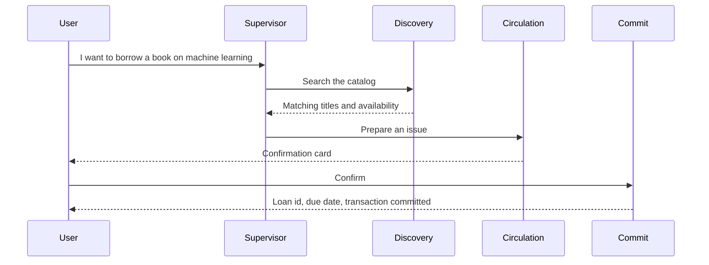
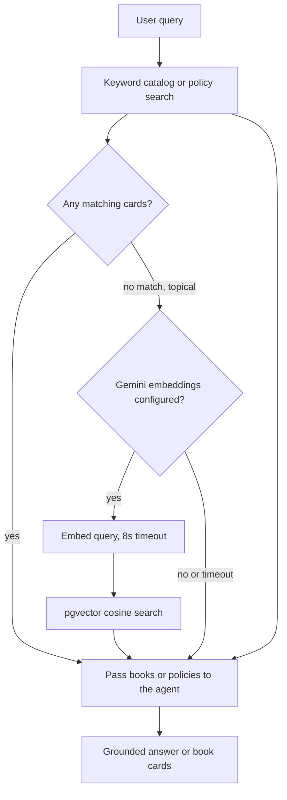
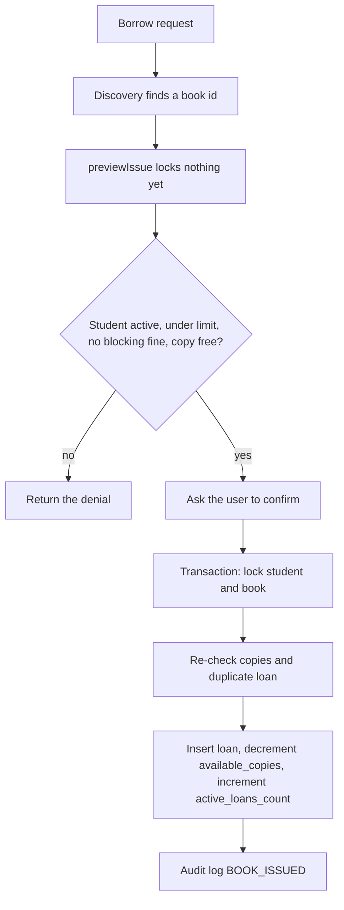
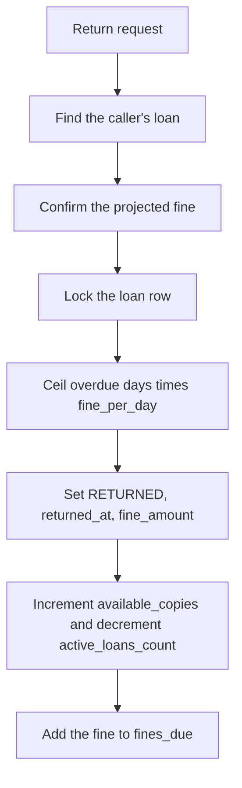
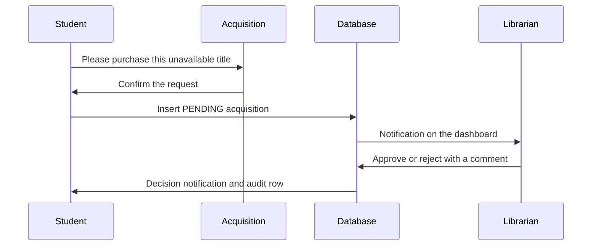

# Agent workflows

The graph is defined in `src/agents/graph.ts`. State is `LibraryAnnotation` in `src/agents/state.ts`. Tool definitions are in `src/agents/tools.ts`.

## Agents

| Agent | Job | Tools |
| --- | --- | --- |
| Supervisor | Read the utterance, choose the next worker, or finish | None. It does not issue books or approve purchases. |
| Discovery | Semantic and keyword search, similar titles, policy retrieval | `searchBooksSemantic`, `searchCatalog`, `searchBooksByCategory`, `getBookDetails`, `checkBookAvailability`, `recommendSimilarBooks`, `searchLibraryPolicies`. Librarians and admins also get `getLibraryStatistics`. Admins get `getAuditLogs`. |
| Circulation | Eligibility, loans, fines, renewal | `issueBook`, `returnBook`, `renewBook`, `getStudentLoans`, `getOverdueLoans`, `calculateFine` |
| Acquisition | Restock and new-title requests, classification drafts | `createAcquisitionRequest`, `suggestBookClassification`, `prepareBookCatalogEntry`. Staff also see `getPendingAcquisitions`. Approve and reject tools are present and always refuse inside chat. |

## Supervisor decision

`planRoute` in `src/lib/routing.ts` is the plan the supervisor follows. It does not wait on Gemini to pick the next agent. `resolveRoute` accepts only an agent that is still in that plan. A pending confirmation forces `confirm_gate` instead of another specialist. After six iterations the supervisor finishes. The reply is composed from tool observations.

## Discovery and RAG

`searchBooksSemantic` embeds the query, reads the nearest books, and drops rows under `SIMILARITY_THRESHOLD`. `searchLibraryPolicies` does the same for policy text and always attaches `currentSettings`. The discovery prompt tells the model to quote those sources. If both vector search and the model are unavailable, the fallback answer is built from tool observations in `composeFallbackAnswer`.

Dewey suggestions come from Gemini structured output when a key exists, otherwise from a keyword table. Every suggestion includes the sentence that a librarian must verify it. `prepareBookCatalogEntry` returns a draft and does not insert a row.

## Book issuance

The student id is taken from the session for a student. A librarian may pass a roll number. The same last copy cannot be issued twice: the book row is locked, `takeCopy` refuses zero, and the partial unique index `loans_one_held_per_student_book` rejects a second held loan of that title.

## Book return

Overdue status is refreshed by `syncOverdue` before lists are read. A return of an already returned loan fails. A student cannot return another student's loan because `listLoans` and `returnBook` filter on the session student id.

## Renewal

An active loan renews once by adding `renewal_duration_days` to the current due date. Overdue loans, returned loans, and accounts with a fine are refused. The same confirmation gate wraps the write.

## Human approval

The model cannot set `APPROVED`. `approveAcquisition` checks the librarian or administrator session and writes `reviewed_by`. Rejection requires a comment of at least three characters. After approval, the librarian may catalog the title, which inserts the book through `bookService` and can generate an embedding if Gemini is configured.

## What the trace panel shows

Each event has an agent, a channel, and a short message. Channels are `agent`, `tool`, `database`, and `approval`. Examples:

- Supervisor: understanding the request, then delegating.
- Discovery: catalogue search started and completed. Semantic search is used only when a topical question has no keyword hit.
- Circulation: eligibility result.
- Database: transaction committed.
- Approval: confirmation required, or librarian decision recorded from the dashboard.

Token text is the final answer only. Intermediate model thoughts are not stored.
