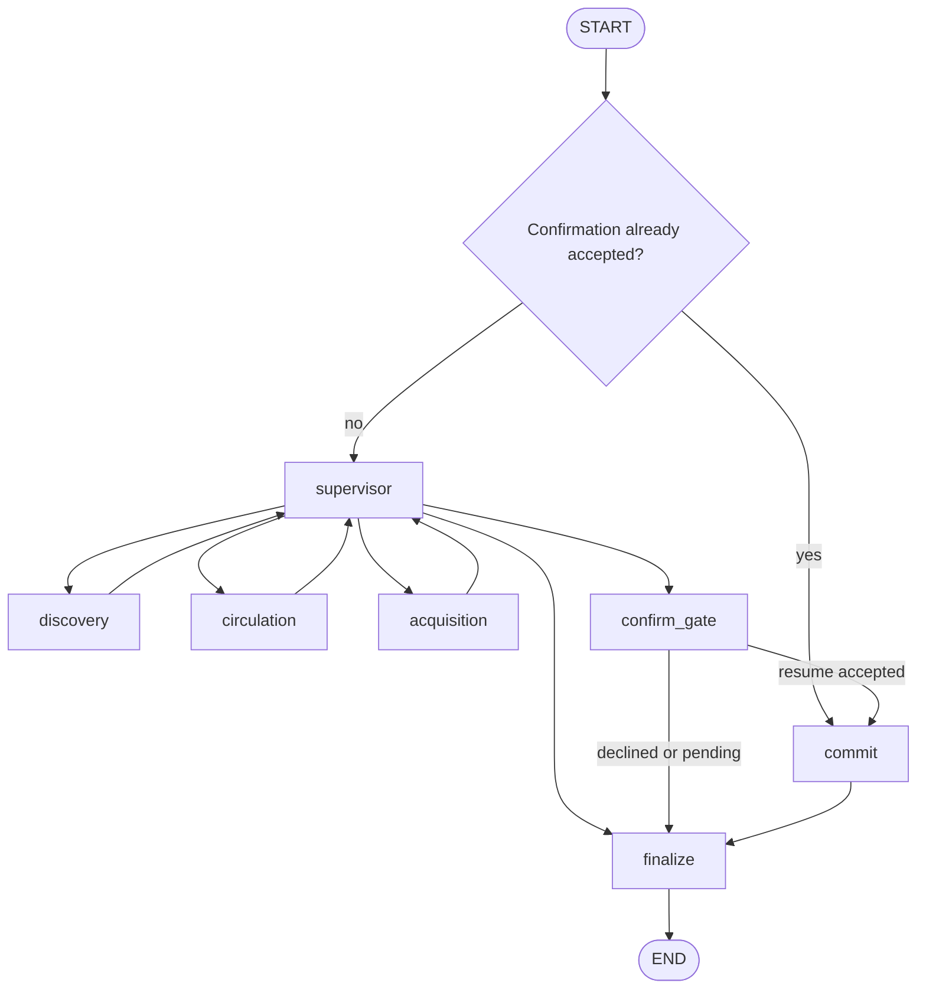

# Architecture

The application is a Next.js App Router project. Pages render the dashboard. Route handlers and server actions enforce identity. Services own business rules. Agents decide which service to call, and they can call only the tools assembled for the signed-in role.

## System context

```mermaid
flowchart LR
  subgraph browser [Browser]
    pages[Dashboard pages]
    assistant[Assistant panel]
  end
  subgraph next [Next.js server]
    proxy[Auth proxy]
    routes[Route handlers]
    graph[LangGraph]
    services[Services]
  end
  subgraph external [External systems]
    gemini[Gemini]
    neon[(Neon PostgreSQL + pgvector)]
  end
  pages --> proxy --> routes
  assistant --> routes
  routes --> graph
  routes --> services
  graph --> services
  graph --> gemini
  services --> gemini
  services --> neon
```

`src/proxy.ts` is the Next.js 16 request gate. It allows `/`, `/login`, `/api/auth`, and `/api/health` without a session. Every other page and API route requires a JWT. Role checks on path prefixes use `canAccessPath`. Handlers still call `requireUser` or `requirePermission`, so a missed proxy rule does not open the data.

## Modules

| Path | Responsibility |
| --- | --- |
| `src/app` | Pages, route handlers, login and logout actions |
| `src/components` | Dashboard shell, assistant, catalog, loans, acquisitions, charts |
| `src/agents` | Graph, state, prompts, tools, specialist runner |
| `src/services` | Books, loans, students, acquisitions, embeddings, analytics, chat, audit |
| `src/db` | Drizzle client, schema, relations, setup, seed |
| `src/lib` | Auth, permissions, Zod validation, routing plan, circulation rules |
| `tests` | Unit tests and an optional Neon integration test |

The database client uses `@neondatabase/serverless` with a WebSocket `Pool`. The HTTP driver cannot run interactive transactions, and circulation needs `db.transaction()` plus `FOR UPDATE`.

## Authentication

`src/lib/auth.config.ts` is safe for the proxy: JWT callbacks only, no database import. `src/lib/auth.ts` adds the credentials provider. Passwords are bcrypt hashes. The session carries `id`, `role`, and `studentId`. A student whose profile is missing or `INACTIVE` cannot sign in. Login attempts are rate-limited and successful sign-ins are written to `audit_logs`.

Roles are `STUDENT`, `LIBRARIAN`, and `ADMIN`. The permission matrix is `src/lib/permissions.ts`.

## Agent runtime



`MemorySaver` checkpoints a turn by `turnId`. A confirmation resume sends a LangGraph `Command`. If the process restarted and the checkpoint is gone, the chat runner starts a fresh graph at the commit node using the confirmation payload stored with the authenticated request. The payload must match the action and the book or loan identifier. The model cannot supply another student's id. Tools read `AgentContext`, which is copied from the server session.

Write tools return a confirmation object when the user has not confirmed. The commit node is what calls `issueBook`, `returnBook`, `renewBook`, or `createAcquisitionRequest`. Approve and reject tools exist for librarians but `assertAgentMayApprove` requires `explicitLibrarianAction`. The chat runner never sets that flag. Approval happens in `POST /api/acquisitions/:id/approve` after the dashboard session is checked.

When Gemini is configured, the supervisor asks for a structured next-agent decision, and each specialist runs a short tool loop. When it is not, specialists execute the same tools from a fixed plan for that intent. Traces label the fallback.

Streaming events are `trace`, `token`, `books`, `confirmation`, and `done`. The assistant stores traces on the chat message. Agent execution rows are written after the turn for the admin monitor.

## Circulation integrity

`issueBook` locks the student and the book, checks status, fines, the held-loan count, the duplicate-title rule, and `available_copies`, then inserts the loan and decrements the copy in the same transaction. `returnBook` locks the loan, computes the fine from the due timestamp, marks it returned, restores a copy, and adds the fine to the student. `renewBook` extends the current due date when the loan is active, under the renewal cap, and the account has no outstanding fine.

Defaults, stored in `library_settings` and editable by an administrator:

- 3 held books, counting `ACTIVE` and `OVERDUE`
- 14 days
- ₹5 per day, with any partial day rounded up to one day
- 1 renewal
- new loans blocked while `fines_due` is greater than zero

## Human approval

An acquisition row starts as `PENDING`. Approving or rejecting sets `reviewed_by`, `reviewed_at`, the comment, and an audit row, and notifies the requesting student when one exists. Cataloging an approved request is a separate librarian action. It inserts a book. It does not treat the suggested Dewey number as a verified classification. The suggestion is stored on the request and copied only when the librarian submits the catalog form.

## Security boundaries

- API keys and `DATABASE_URL` are read on the server.
- Zod parses every JSON body.
- Agents cannot run arbitrary SQL.
- Student loan tools ignore a roll number supplied for a student session and use `studentId` from the session.
- Students do not receive statistics, audit, or approval tools.
- Chat is limited to 30 requests per user per IP per minute. Login is limited to 8 attempts per email per 10 minutes. The limiter is in-memory, so it resets on deploy.
- User text passed into prompts is fenced in `src/lib/response.ts`. Tool results are JSON from services, not raw SQL errors with connection strings.
- Failed responses from route handlers return a generic 500 message. Domain errors return their status and a short message.
