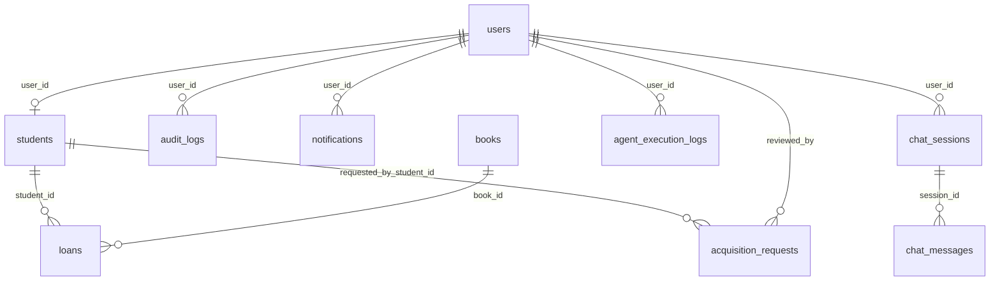

# Database schema

The Drizzle schema is `src/db/schema.ts`. The runtime client is `src/db/index.ts`. Relations are `src/db/relations.ts`. Vector indexes are applied by `src/db/setup.ts` and `drizzle/manual/001_vector_indexes.sql`.

Enable the extension before push:

```sql
CREATE EXTENSION IF NOT EXISTS vector;
```

Embeddings are `vector(768)` unless `EMBEDDING_DIMENSIONS` is changed before the schema is pushed. HNSW indexes use cosine ops on `books.embedding` and `library_policies.embedding`.

## Relationships



A person has one `users` row. Students have a second `students` row for roll number, fines, and loan counts. Librarians and administrators do not need a student row. Password hashes live only on `users`.

## users

| Column | Type | Notes |
| --- | --- | --- |
| id | uuid | Primary key |
| name | varchar(255) | |
| email | varchar(255) | Unique |
| password_hash | varchar(255) | bcrypt |
| role | user_role | `STUDENT`, `LIBRARIAN`, `ADMIN` |
| created_at, updated_at | timestamptz | |

## students

| Column | Type | Notes |
| --- | --- | --- |
| id | uuid | Primary key |
| user_id | uuid | Unique, cascades with `users` |
| roll_no | varchar(50) | Unique |
| name, email | varchar | Email unique |
| department | varchar(100) | Nullable |
| semester | integer | Nullable |
| active_loans_count | integer | Check `>= 0` |
| fines_due | numeric(10,2) | Check `>= 0` |
| status | student_status | `ACTIVE` or `INACTIVE` |
| created_at | timestamptz | |

## books

| Column | Type | Notes |
| --- | --- | --- |
| id | uuid | Primary key |
| isbn | varchar(20) | Unique |
| title, author | varchar | Indexed |
| publisher | varchar(255) | Nullable |
| publication_year | integer | Nullable |
| category | varchar(100) | Indexed |
| description | text | Embedded when it changes |
| dewey_decimal | varchar(20) | Stored value, not a claim of official classification |
| total_copies, available_copies | integer | `available <= total`, both `>= 0` |
| embedding | vector(768) | Nullable until generated |
| content_hash | varchar(64) | Hash of the embedded text |
| created_at, updated_at | timestamptz | |

## loans

| Column | Type | Notes |
| --- | --- | --- |
| id | uuid | Primary key |
| book_id, student_id | uuid | Restrict on delete |
| issued_at, due_date | timestamptz | |
| returned_at | timestamptz | Null while held |
| fine_amount | numeric(10,2) | Check `>= 0` |
| renewal_count | integer | Check `>= 0` |
| status | loan_status | `ACTIVE`, `RETURNED`, `OVERDUE` |
| created_at | timestamptz | |

Indexes cover book, student, status, and due date. `loans_one_held_per_student_book` is unique on `(student_id, book_id)` where status is `ACTIVE` or `OVERDUE`.

## acquisition_requests

| Column | Type | Notes |
| --- | --- | --- |
| id | uuid | Primary key |
| book_title | varchar(500) | |
| author, isbn | varchar | Nullable |
| reason | text | |
| requested_by_agent | varchar(50) | |
| requested_by_student_id | uuid | Nullable |
| suggested_category, suggested_dewey_decimal | varchar | AI suggestion |
| estimated_cost | numeric(10,2) | Nullable. The assistant does not commit a price. |
| priority | varchar(20) | Default `MEDIUM` |
| status | acquisition_status | `PENDING`, `APPROVED`, `REJECTED` |
| librarian_comment | text | |
| reviewed_by | uuid | User who decided |
| created_at, reviewed_at | timestamptz | |

A pending request with the same title is reused instead of inserting a duplicate.

## library_policies

`policy_name`, `policy_content`, `category`, `embedding`, `content_hash`, `is_active`, timestamps. Retrieval filters to active rows. List responses omit the embedding.

## library_settings

One row per `setting_key`. Keys used by circulation and RAG:

- `max_loans_per_student`
- `loan_duration_days`
- `fine_per_day`
- `max_renewals`
- `renewal_duration_days`
- `block_borrow_when_fines_due`
- `similarity_threshold`
- `policy_similarity_threshold`
- `semantic_result_limit`

## audit_logs

`user_id`, `action`, `entity_type`, `entity_id`, `details`, `ip_address`, `created_at`. Actions include book issue, return, renewal, acquisition requested, approved, and rejected, student changes, login, settings, and policy updates.

## notifications

Per-user title, message, type (`INFO`, `WARNING`, `ERROR`, `SUCCESS`), read flag, and optional link. Acquisition decisions notify the student. New pending requests notify librarians and administrators.

## agent_execution_logs

One row per specialist step: session id, agent name, action, truncated input and output, tool names, duration, status, and user id. The agent monitor aggregates these rows. The seed does not invent them.

## chat_sessions and chat_messages

Sessions belong to a user. Messages store `user` or `assistant` content, JSON traces, and JSON metadata for book cards and confirmations.

## Seed order

`src/db/seed.ts` checks that tables exist, truncates application tables, inserts users, students, settings, policies, books, loans, acquisitions, notifications, and audit rows, then generates embeddings when a Gemini key is set and creates vector indexes. Running it twice wipes the previous demo data.
