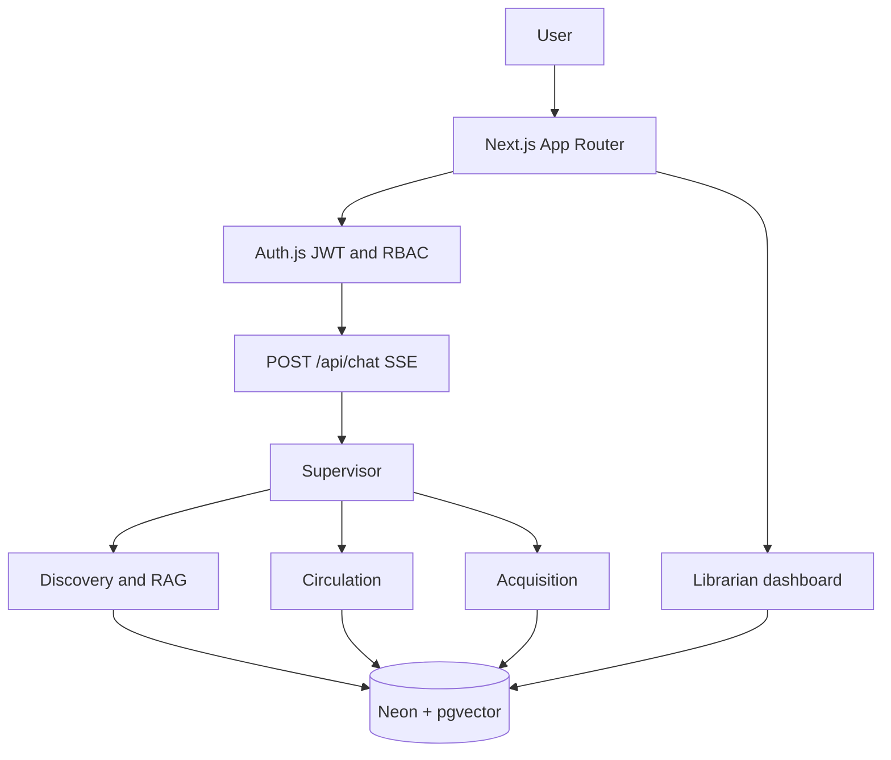

# Project report

**Title:** Autonomous Multi-Agent Library Management System Using Generative AI, LangGraph, Next.js, and Neon PostgreSQL

**Course context:** B.Tech Generative AI laboratory

## Abstract

The project replaces a single library chatbot with a supervisor and three specialist agents. Discovery searches a PostgreSQL catalog with pgvector. Circulation issues, returns, and renews books inside locked transactions. Acquisition records purchase requests that stay pending until a librarian decides. The Next.js dashboard shows the handoff, the tool that ran, and the database result. Policies are retrieved from stored text. The model is not allowed to invent a borrowing rule, run SQL, or approve a purchase.

## 1. Introduction

University libraries already have tables for books and loans. The missing piece in many generative demos is the connection between language and those tables. A fluent answer that does not decrement `available_copies` is not a circulation system. This project treats the language model as a router and a writer of the final sentence. The state change is ordinary, tested application code.

## 2. Problem statement

Students ask for titles, availability, loans, fines, and purchases in one conversation. Those requests need different authority. Search can be wrong and merely unhelpful. A loan or a purchase must be correct under concurrency, and a purchase must wait for a person. The system also has to show an examiner that more than one agent participated.

## 3. Objectives

1. Route each utterance through a supervisor to the smallest set of specialists.
2. Ground book and policy answers in retrieved rows.
3. Keep issue, return, and renewal atomic.
4. Record acquisition requests and librarian decisions in an audit log.
5. Expose the same operations in a role-based dashboard.
6. Keep model names, thresholds, and circulation limits outside the source code.

## 4. Literature and design choices

Supervisor-worker graphs match the library desk: one person hears the request and sends it to search, circulation, or acquisitions. LangGraph provides the shared state, conditional edges, a checkpointer, and an interrupt for confirmation.

Retrieval-augmented generation is used for descriptions and policies because those texts live in the database and change when a librarian edits them. Cosine similarity over pgvector keeps the vectors next to the relational rows, so a book and its embedding commit together.

Human-in-the-loop is implemented twice. Short confirmations (issue, return, renew, open a request) interrupt the graph until the same user clicks confirm. Long approvals (buy a book) are rows another user acts on later. A paused student graph would not survive for days, and it would still be the wrong actor pressing approve.

## 5. System architecture

The implementation map is in [ARCHITECTURE.md](ARCHITECTURE.md). Workflow diagrams are in [AGENT_WORKFLOWS.md](AGENT_WORKFLOWS.md).

## 6. Methodology

Work followed the stack in the problem statement.

1. Next.js 16, TypeScript, Tailwind, Drizzle, LangGraph, and Auth.js were installed in `autonomous-library`.
2. The schema added checks, a partial unique loan index, content hashes, audit, notifications, settings, and chat tables around the requested books, students, loans, acquisitions, policies, and users.
3. Services implement search, transactions, approvals, analytics, and embeddings.
4. The graph delegates, confirms, commits, and streams traces.
5. Dashboard pages read those services. Students do not see staff navigation. A student borrows from the catalogue or the assistant, then returns or renews on Active Loans. Both paths call the same loan service.
6. Unit tests lock the circulation rules. An integration test is ready for Neon.

`gemini-3.5-flash` is the default chat model and `gemini-embedding-001` is the default embedding model, both overridable. Embeddings are requested at 768 dimensions. `gemini-2.5-flash` is no longer available to new keys, so that name is mapped to `gemini-3.5-flash`. If the chat model fails, the deterministic plan still calls the database tools.

## 7. Implementation notes

**Identity.** Students, librarians, and administrators share `users`. Only students have a profile row. The assistant copies the session into `AgentContext` and does not trust a model-supplied student id.

**Fallback.** Missing API keys do not invent embeddings or a fake agent transcript. The planner selects the worker, the worker calls the real tool, and the trace states that the deterministic plan was used.

**Fines.** `ceil(overdue milliseconds / 1 day) * fine_per_day`. A loan returned one hour late costs one day. The seed example is ₹5 per day, so four days is ₹20, which matches Meera's returned Kleppmann loan.

**Concurrency.** Eight in-memory borrowers share a mutex and a single copy. One succeeds. On Neon, the integration test repeats that with two transactions and row locks.

**Policies.** Five documents cover the limit, the 14-day period, fines, renewal, and who may return a book. The settings table is authoritative if an administrator changes a number. The policy tool returns both.

## 8. Results

Commands run in this workspace on 20 November 2026:

| Check | Result |
| --- | --- |
| `npx tsc --noEmit` | Passed |
| `npx eslint src tests --max-warnings 0` | Passed |
| `npm test` | 22 passed, 1 skipped |

The skipped test is the Neon integration file. It skips itself when `DATABASE_URL` is unset. This machine had no `.env.local`, so schema push, seed, live Gemini calls, semantic search, login, and the signed-in dashboard were not executed here.

What the unit tests demonstrate:

- Partial overdue days count as one day, and four days at ₹5 cost ₹20.
- Inactive students, outstanding fines, duplicate titles, the loan cap, and zero copies are refused.
- Renewals refuse returned and overdue loans.
- Routing sends a search to discovery, a borrow through discovery then circulation, and a purchase through discovery then acquisition.
- Students lack acquisition approval, analytics, and agent-monitor permissions. Librarians can decide acquisitions and cannot open settings. Administrators can.
- Only one of eight concurrent borrowers receives the last copy.

## 9. How to demonstrate

After Neon and Gemini credentials are configured:

1. `npm run db:setup`, `npm run db:push`, `npm run db:seed`.
2. Sign in as `student@library.edu` / `Student@123`. If the overview is empty after a reseed, sign out and sign in once more.
3. Ask for books on generative AI and confirm the cards come from the catalog.
4. Borrow *Clean Code* from **Book Catalogue**, or ask the assistant to borrow *Operating System Concepts* and confirm. The available count drops by one. Return it from **Active Loans**.
5. Ask which books are on loan, then return one and observe the fine when the loan is overdue.
6. Ask about the borrowing limit and compare the answer with **Library Policies**.
7. Ask the library to purchase a title that has no copies, such as another copy of Kurose and Ross. Sign in as the librarian and approve or reject it. The audit log records the decision.
8. Sign in as the administrator and open **Agent Activity**. Rows appear only after real turns.

## 10. Limitations

- LangGraph memory is process-local. A new server instance does not resume an old checkpoint. The commit path can still complete from the signed confirmation payload.
- The rate limiter is in-memory.
- Fine payment is recorded as a balance. There is no payment gateway.
- Dewey numbers are suggestions.
- A reseed changes every user id. Old JWTs must sign in again before chat or loans will match a student.
- Integration coverage of semantic search runs only with a Gemini key and `DATABASE_URL`.

## 11. Conclusion

The project shows a supervisor coordinating discovery, circulation, and acquisition against a real schema and real transaction boundaries. Language selects the work. Services perform it. A librarian remains the person who can approve a purchase. That split is the property a laboratory examiner can verify from the trace panel, the loan row, and the acquisition status.

## References

1. LangChain, LangGraph.js documentation, checkpointing and interrupts.
2. Google AI, Gemini model and embedding documentation. Model ids in this project are environment settings.
3. Neon, serverless PostgreSQL and the pgvector extension.
4. pgvector, cosine distance and HNSW indexes.
5. Next.js App Router and Auth.js credentials sessions.
